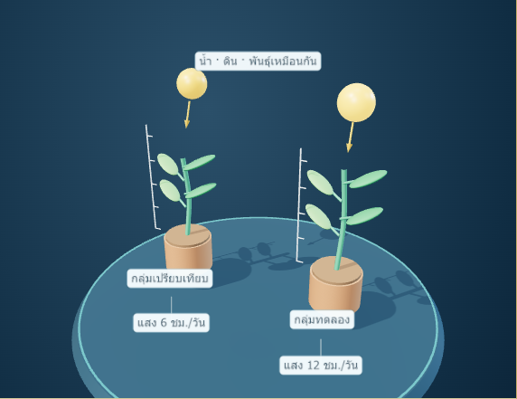
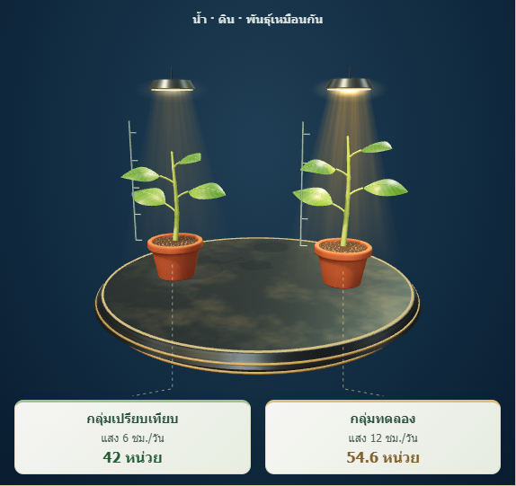

# ต้นแบบ 3D: แสงกับต้นถั่ว

ปรับเฉพาะ Simulation `G1U1L1` — “ทดลองทีละตัวแปร: แสงกับต้นถั่ว” โดยใช้โมเดลการทดลองเดิมทั้งหมด และคงกรอบ Premium Voxel Adventure ของเว็บไซต์

Baseline: `672397e25c66af22108fa16277f9b463cf430c5e` สำรองไว้ที่ branch `checkpoint/plant-fidelity-20261014` ก่อนแก้ไข ไม่มีงานเดิมใน working tree ถูกทับ

ปรับต่อวันที่ 15 ตุลาคม 2026 จากต้นแบบ commit `8130ef4` ตามภาพอ้างอิง: ใบมีความหนาและผิวมันวาว ลำต้นมีข้อปล้อง โคมไฟสีทองพร้อมลำแสง แท่นโลหะมีเงาสัมผัส และฉาก Deep Navy ปรับระยะกล้องให้เห็นต้นไม้ โคมไฟและแท่นครบในมุมเริ่มต้น/หน้า/บน ภาพหลังด้านล่างเป็นภาพจาก Interactive 3D จริง

## ภาพก่อนและหลัง

ทั้งสองภาพใช้ iPad landscape viewport 1024×768, แสงกลุ่มทดลอง 12 ชั่วโมง/วัน, วันที่ 14 และกล้องเริ่มต้นของแต่ละรุ่น

| ก่อน | หลัง |
| --- | --- |
|  |  |

พื้นที่แสดงโมเดลรุ่นใหม่สูงขึ้นเพื่อสำรองแถบป้ายด้านบนและด้านล่างโดยไม่ทับ canvas ภาพเพิ่มเติมและรายงาน JSON อยู่ใน `tmp/plant-fidelity-review/`

## สิ่งที่เปลี่ยน

- `assets/simulations/plant-growth-model.js`: ใบโค้งปลายแหลมมีผิวบน/ล่างและขอบปิด เส้นกลางใบแบบ geometry เส้นใบย่อยเป็น texture เพื่อลดจุดรบกวนเมื่อย่อภาพ วัสดุใบมี clearcoat และเฉดเขียว ลำต้นมีข้อปล้องใน geometry เดิม กระถางดินเผาขอบหนา ดินเข้มและเม็ดดินแบบ instancing ใช้ geometry/material ร่วมกัน ไม่เพิ่มไลบรารี
- `assets/simulations/plant-growth-studio.js`: โคมไฟสองดวง ลำแสงสีทองด้วย shader แบบ single pass แสงเรืองและ spotlight ตามค่าแสงเดิม ปิดแสงกลุ่มทดลองที่ 0 ชั่วโมง/วัน แท่นโลหะมีผิวละเอียด ขอบทอง และ contact shadow ใต้กระถางแบบ texture ร่วมกัน ใช้ shadow map เดียวและคงระบบลดรายละเอียดตามสมรรถนะ คืน geometry/material/texture และจุดเป้าหมายของไฟเมื่อออกจากบทเรียน พร้อมรองรับ dispose ซ้ำ
- `assets/simulations/scene3d.js`: ปรับกล้องเฉพาะ `spec.id === 'G1U1L1'` คำนวณระยะจากขอบเขตฉากที่ความสูงสูงสุดเพื่อไม่ตัดแท่นหรือโคมไฟ มุมหน้า/บนปรับระยะตาม perspective และ aspect ratio ใช้ OrbitControls, ปุ่มและพฤติกรรมเดิม ภาพการเติบโต interpolate ไปยัง endpoint จาก builder เดิม
- `assets/simulations/studio3d.css`: หน้าต่างทดลองสีครีม–เขียว ขอบสีทอง แผงควบคุมและป้ายอ่านค่าที่ปรับเฉพาะการทดลองนี้ ป้ายอยู่นอกพื้นที่ canvas ปุ่มทั้งหมดมีพื้นที่แตะอย่างน้อย 44×44 px รวมถึงปุ่ม 3D/2D บนมือถือ
- `tests/plant-growth-regression.mjs`, `tests/plant-growth-browser.mjs`: ตรวจค่าจาก baseline และการทำงานจริง
- `.github/workflows/pages.yml`: เพิ่ม regression ของต้นแบบและตรวจว่ามีโมดูลใหม่ครบก่อนเผยแพร่

## สิ่งที่คงเดิม

`index.html`, ข้อมูลหลักสูตร, `core.js`, `grade1.js`–`grade3.js`, `engine.js`, registry และ builder ทั้งหมด รวมถึง `models3d-kit.js` ไม่เปลี่ยน เนื้อหา รูปภาพ คำถาม คะแนน progress authentication routing และ schema การบันทึกคงเดิม

สูตรเดิมคือ `controlGrowth = t * 3` และ `experimentGrowth = t * 3 * Math.min(light / 6, 1.3)` โดยแสงอยู่ในช่วง 0–12 ชั่วโมง/วัน และเวลา 0–14 วัน การแสดงความสูงลำต้นยังใช้ `55 + 2 * growth` จากฐานเดิม `-72` ไม่มีการเพิ่มการเหี่ยว สีใบ จำนวนใบ หรือผลทางชีววิทยาที่ขึ้นกับแสงขึ้นมาใหม่

ข้อความสมมติฐานเดิมยังแสดงว่าเป็นข้อมูลสมมติสำหรับฝึกควบคุมตัวแปร ไม่ใช่สูตรทำนายความสูงต้นถั่วจริง หน่วยที่แสดงยังเป็น “หน่วย” ไม่เปลี่ยนเป็นเซนติเมตร

## ผลตรวจ

- ตรวจแสงทุกค่าจำนวนเต็ม 0–12 กับวันที่ 0–14 ครบ **195 คู่ค่า**: SVG 2D, ข้อสรุป, metrics, modelState, ค่าที่บันทึก และ endpoint ภาพ 3D ตรงต้นฉบับ
- ตรวจ source สำคัญ 10 ไฟล์และข้อมูลหลักสูตรด้วย baseline fingerprint; builder ของอีก **39 การทดลอง / 278 กรณี** ไม่เปลี่ยน
- Chrome: **7 ขนาดจอ × 3 สถานะ = 21 กรณี** ได้แก่ 375×812, 390×844, 430×932, 768×1024, 1024×768, 1366×900, 1440×900 ไม่มี page overflow ป้ายซ้อน ป้ายทับ canvas หรือข้อความถูกตัด ปุ่มควบคุมอย่างน้อย 44×44 px
- ตรวจมุมเริ่มต้น/หน้า/บน ที่แสง 0/6/12 ชั่วโมง วันที่ 14 ครบ **63 กรณี** ทั้งขอบเขตฉากและการฉาย vertices ของ geometry จริง ต้นไม้ กระถาง ไม้บรรทัด โคมไฟและแท่นอยู่ในกรอบทั้งหมด ตรวจการหมุนครบ 360° และเริ่ม/หยุดหมุนอัตโนมัติ
- WebKit จำลอง iPad ทั้งสองแนวที่ DPR 2: **6 กรณี** พร้อมแตะปุ่มกล้องและสลับ 3D/2D
- หมุนทีละ 15° หมุนด้วยเมาส์และนิ้ว ซูมเข้า/ออกและ pinch สองนิ้ว มุมหน้า/บน/เริ่มต้น แป้นพิมพ์ ซ่อนป้าย หมุนอัตโนมัติ เล่น/หยุดเวลา หยุดที่วันที่ 14 รีเซ็ต เปิดค่าหลัง reload และหยุด timer เมื่อเปลี่ยนกิจกรรม
- ตรวจ interpolation ว่ามีค่าภาพระหว่างทาง ไม่ย้อนกระโดด และจบที่ endpoint เดิม รวมถึง `prefers-reduced-motion`
- จำลองเฟรมช้าต่อเนื่องเพื่อทดสอบลดรายละเอียดโดยไม่เปลี่ยนผลวิทยาศาสตร์ ไม่สลับระดับไปมา และตรวจปล่อย geometry/material/texture ที่สังเกตได้ครบเมื่อ dispose
- ตรวจโคมไฟที่ 0, 6 และ 12 ชั่วโมง/วัน: ค่าความสว่างเป็นจำนวนจำกัด เพิ่มตามค่าแสง ปิดลำแสง/แสงเรือง/spotlight ที่ศูนย์ และไม่เปลี่ยนไฟกลุ่มเปรียบเทียบหรือค่าการเติบโต ตรวจคืนทรัพยากรของโคมไฟ พื้นผิวแท่น และนำจุดเป้าหมายของไฟออกจากฉากครบ
- ชุดเดิม `simulation-regression.mjs`, `native-models-regression.mjs` และการตรวจ build/deployment ผ่าน
- Browser regression ของการทดลองทั้ง **40 บท / 84 ตัวควบคุม / 120 layout** ผ่าน ไม่มี JavaScript errors พร้อมตรวจ fallback เมื่อไม่มี WebGL, context loss, touch, WebKit และการควบคุมกล้องเดิม

เฉพาะโมเดลต้นถั่วสองต้นใช้ 14 meshes ทั้งสองระดับ: ระดับสูง 31,600 สามเหลี่ยม ระดับต่ำ 15,448 สามเหลี่ยม ระดับต่ำลด segments ของใบ ลำต้น ดิน และกระถาง รวมถึงเม็ดดิน 96 เป็น 32 ต่อต้น เส้นกลางใบและ texture เส้นใบย่อยยังอยู่ครบ ลด shadow map และจำกัด DPR ตามระบบเดิม การวาดหยุดเมื่อภาพนิ่ง ออกจาก viewport หรือซ่อนแท็บ

ตัวนับ renderer ของฉากเต็มจากชุดทดสอบ: สูงสุด 47 draw calls, 42,552 สามเหลี่ยมในระดับสูง และ 26,400 ในระดับต่ำ ตัวเลขนี้เป็น render pass ที่แสดงภาพ ไม่ใช่ผลวัด FPS หรือผลรวมต้นทุนทุก shadow pass ตรวจ console ของ WebGL/การ compile shader และการคืนทรัพยากรรวมถึงการเรียก dispose ซ้ำผ่าน

## ข้อจำกัดและขอบเขตการตรวจ

ทดสอบผ่าน Chrome และ WebKit บนเครื่องพัฒนา รวมถึงการจำลอง touch/iPad ไม่ใช่การตรวจบน iPad/iPhone/Android เครื่องจริง จึงยังไม่รับรอง FPS หรืออุณหภูมิบนอุปกรณ์จริง การทดสอบเฟรมช้าเป็นการฉีดค่าทดสอบกลไกปรับคุณภาพ ไม่ใช่ผล benchmark เครื่องผู้ใช้

รอบนี้หยุดที่ต้นแบบต้นถั่วนี้ ไม่มีการขยายโมเดลหรือรูปลักษณ์ใหม่ไปยังการทดลองอื่น

## รันตรวจซ้ำ

```powershell
node tests/plant-growth-regression.mjs
node tests/plant-growth-browser.mjs
node tests/simulation-regression.mjs
node tests/native-models-regression.mjs
node tests/simulation-3d-browser.mjs
```

Browser suite ต้องมี Playwright และ Chrome/WebKit พร้อม Git commit baseline อยู่ใน local history ใช้ browser context ชั่วคราว ไม่แตะข้อมูลนักเรียนใน browser จริง
